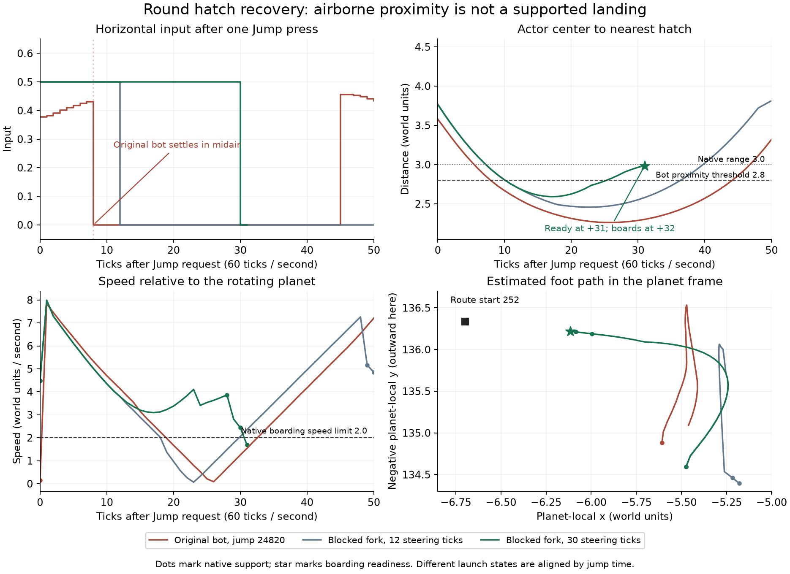

# The blocked Round pilot can reach and board its ship

**Four ordinary-input trials board the rebuilt ship from the retained blocked
state at tick 26229.** Each uses one native jump and completes boarding before
the local terrain changes. The unchanged bot remains blocked for its full
600-tick comparison. This establishes a missed recovery opportunity in the
seed-20202 Round/collapse-off case, unlike the enclosed Angular case.

The next policy experiment should address premature hatch arrival: the bot
stops steering when its airborne actor passes close to the hatch, before it
reaches supported landing ground. Continued steering supplies the retained
witnesses. A production arrival-gate change has not yet been isolated or
validated; no production controller or physics change is included here.

## What the native replay shows



The original mission is reconstructed from tick zero through 26829. Every
action, decision checksum and scenario checksum matches the retained mission.
Native route inspections at 24743 and 26229 also equal the preceding investigation.
The existing candidate-P2 recovery profile is explicitly selected; the later
Angular experiments are disabled. The complete world, both controllers and host
queues are cloned at each fork. The opponent remains reactive.

The [prespecified matrix](terrain-recovery-round-entry-plan.md) crosses five
horizontal inputs, three launch delays and two steering durations at each fork.
Only P2's surface-control action changes. Jump is pressed once on eligible
native support, then released; there is no held vertical jetpack thrust. The
same bot keeps deciding during the intervention, and receives control again
without a memory reset. An ordinary fresh Interact press is allowed when native
boarding readiness reports Ready. Each trial ends at boarding, match end or
600 ticks.

| Fork | Trials | Scripted jumps accepted by native physics | Native boardings | Unchanged control |
| --- | ---: | ---: | ---: | --- |
| Rebuild, 24743 | 30 | 6 | 0 | No boarding or route-entry progress |
| Already blocked, 26229 | 30 | 30 | 4 | Blocked for all 600 ticks |

**The early negative trials have a harness limitation.** Controls are disarmed
at 24743 and require a neutral surface input before rearming. The 24 nonzero
horizontal recipes never send that neutral input while scripted, so their
nominal Jump presses are ignored. The six zero-horizontal recipes do rearm and
jump. Per-tick rows omitted the armed flag, but the full fork snapshot retains
it; the native counters and scripted inputs confirm the missing neutral release.
All original outputs remain frozen. These 24 trials cannot support a conclusion
about those movement choices. A future early-fork probe must wait for real input
arming. The later fork is already armed and all 30 launches are accepted.

All four successful trials use 30 steering ticks after launch:

| Horizontal | Delay | Jump tick | Boarded tick | Ticks from fork | Hatch distance at Ready | Relative speed at Ready |
| ---: | ---: | ---: | ---: | ---: | ---: | ---: |
| 0.5 | 0 | 26236 | 26268 | 39 | 2.986 | 1.686 |
| 0.5 | 12 | 26245 | 26273 | 44 | 2.739 | 1.401 |
| 0.5 | 24 | 26254 | 26286 | 57 | 2.783 | 1.506 |
| 1.0 | 12 | 26245 | 26273 | 44 | 2.751 | 1.990 |

At each Ready observation the pilot is balanced, supported by its own planet's
retained collider, within the native three-unit hatch range and below the
two-unit relative-speed limit. The ship is landed. A fresh Interact press
produces an aboard state, `last_transfer = boarded`, and exactly one additional
transfer. Terrain revision remains 189 throughout each successful continuation.
These are four witnesses from one physical state, not independent battles or
a success-rate estimate. The harness stops at boarding; completion of the bot's
recovery task and subsequent combat still require a live-policy continuation.

Two successes enter the 0.85-unit supported neighborhood of route node 252;
two board without entering it. None needs to reach node 253 first. Native
boarding can therefore legitimately finish before the sampled route completes.
The blocked controller's waypoint remains zero during every late probe because
its policy is unchanged; physical entry and controller progress are reported
separately.

## Execution difference

The original ground task plans `[252, 253]` but never advances from waypoint
zero. From rebuild through blocking at 26228 it requests 22 jumps. Native
physics records 17 jumps and five get-up attempts instead. The distinction
matters: requesting Jump while misaligned is not evidence of a failed jump.

The first accepted jump occurs at 24820. Eight ticks later, at 24828, the actor
is 2.7935 units from the hatch and still has no support. `GroundNavigationTask`
treats that proximity as arrival, selects Settle and returns zero horizontal
input. The pilot remains unsupported and eventually falls back. This interval
contains 486 airborne Settle ticks before blocking.

The half-input witness continues steering through that airborne proximity
region, reaches actual support and boards. Its otherwise identical 12-tick
steering trial hands control back while still airborne and fails. This paired
duration comparison supports continued steering as a useful mechanism. The
original bot's first jump and the later witness have different launch states,
so their comparison alone does not establish that one arrival-condition edit
will fix the live controller. The figure explicitly aligns those different
states by jump time. Its foot positions are center-minus-up estimates, not
collider bottoms or a drawing of the terrain.

The six conservative connectivity grids remain open at the query boundary at
both Round forks. They provide no enclosure certificate and do not establish
executability. The native boarding witnesses supply the positive evidence.

## Checks and reproducibility

Runtime source: `4731bdb92348d7ad503c1a411ccc9f409f8ba3d1`.
Frozen binary SHA-256:
`61ee9558455944f8b2e99d7444c201ac685d8d5d875b47c5f1c3c075268b7bee`.

The first simulation run and first independent audit pass. The expanded audit
also passes: 2,424 source inputs, 382 case artifacts, 26,829 verified control
decisions and 33,784 intervention ticks. It checks native boarding gates, final
transfers, first-state physical equality, unchanged non-surface actions, all
recipe outcomes, the early rearming limitation, and material conservation/speed
samples. After freezing, only audit/report/figure/packaging code changed; the
runtime and all original simulations remain unchanged.

**451 AI tests pass**, with 15 ignored diagnostics. Strict AI Clippy,
default-feature compilation and formatting pass. Validation logs are retained;
their consolidated receipt distinguishes them from the exact structured build
and diagnostic command receipts. This leg changes only an ignored test harness
and evidence tooling, so the native suites from the preceding connectivity leg
were not repeated.

The [compact receipt](data/terrain-recovery-round-entry-v1.json) includes every
trial, gate measurements, hashes, validation and figure provenance. Raw data is
in `spacewars-handoffs/round-entry-20261010`. The verified package is
`spacewars-handoffs/terrain-recovery-round-entry-20261010.tar.gz`; its incremental
source bundle requires `afb59f9` from the pocket-connectivity package.

```sh
python3 tools/audit-terrain-recovery-round-entry.py /path/to/round-entry-20261010 --output /tmp/round-entry-audit.json
```

To rerun the frozen experiment, invoke `round-entry-diagnostic` with test
`mission_pilot::terrain_recovery::qualification::round_entry::retained_round_hatch_entry`
and `--ignored --exact --nocapture`. Set `RUST_MIN_STACK=16777216`,
`SPACEWARS_MISSION_REFERENCE` to the packaged `references` directory, and
`SPACEWARS_RECOVERY_OUT` to a new directory. The harness rejects existing output.
The package includes the frozen source manifest, exact command/environment,
full traces, native snapshots, both controllers, audits, PNG/PDF figures and
plotting dependencies. Reproduction intentionally preserves the documented
early-input limitation.

## Next controlled policy test

Prototype an independently selectable hatch approach change in #178: while
following an existing measured route, proximity alone must not stop airborne
steering. Retain the current route steering until actual footing permits a
quiet arrival, with native Ready still taking precedence. Preserve flag-claim
settling, rebuild arrival, jump/get-up gates, route validation, time limits and
the default policy. Do not encode these seed, node, tick or recipe values in
the bot, or add a broad blocked-task reset to this first comparison.

Reconstruct the same rebuild fork, let the original neutral input arm controls,
and compare candidate versus unchanged policy with identical initial physics
and controller memory. Require native boarding followed by task completion,
then continue the mission. Qualify the candidate on both terrain shapes,
collapse settings and seats, and cover normal supported hatch arrival, brief
contact loss, no usable route and unrelated flag-claim behavior. A failed
candidate must remain a retained result rather than justify more retries.

The Angular/collapse-off enclosure remains an expected blocked case. The
Angular/collapse-on replacement-distance gate and placement cost remain
separate. Published #174 integration and device qualification are still pending.
Work remains local on `bot-round-hatch-entry`; the original #178 checkout is
unchanged at `cada1eb`. No defaults, deployment or GitHub state changed.
