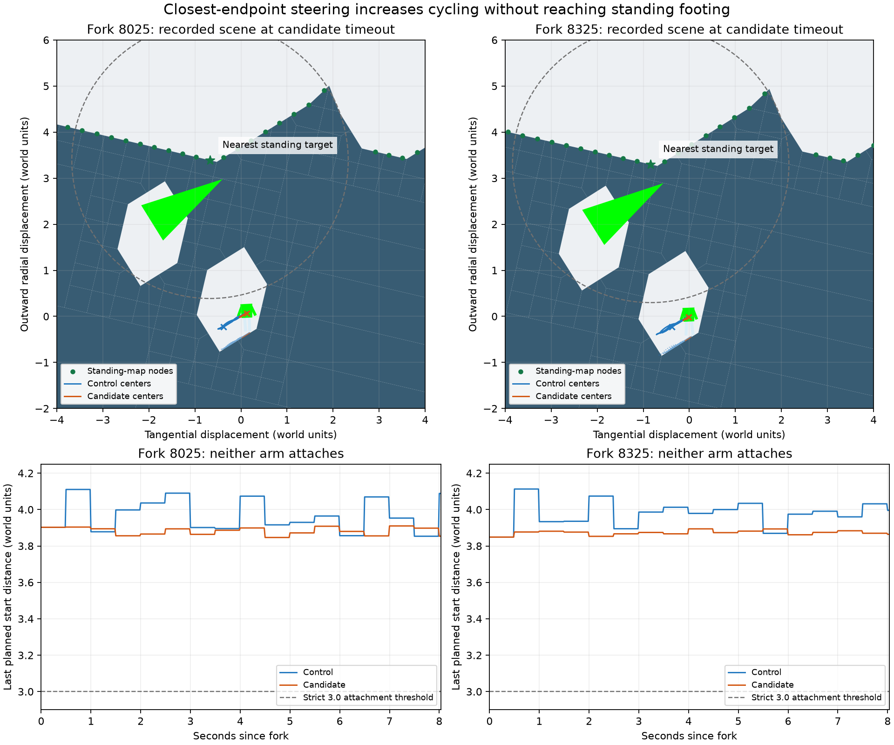

# Closest-endpoint steering increases cycling without completing recovery

**The new direction policy fails both retained attempts and increases direction
reversals.** Choosing the closest measured corridor endpoint does not produce
standing-route attachment, native rebuilding or boarding. Do not promote this
selector on this evidence. Keep it independently selectable for comparison.

The retained scene supplies a more useful next hypothesis: the actor appears
inside a small terrain pocket, separated from the outer standing map by retained
material. Confirm the native collision connectivity before tuning another
steering heuristic or extending the attempt budget. Render geometry and eight
straight sweeps do not prove that every physical escape is impossible.

## Frozen comparison

The [plan](terrain-recovery-target-direction-plan.md), implementation, tests,
harness and auditor were frozen at `080c79fa5526925c8e856a8a2f40b2f0d58bb156`.
The binary SHA-256 is
`b5b2afe338340e749061aa832b7ebbde2d22ad8974945b3bd7f517abb19f7c0b`.

Forks 8025 and 8325 are the same prespecified seed-20202 Angular/collapse-off
candidate-P2 states used by the preceding experiments. Reconstruct and verify
the original mission prefix, then clone the native world, both existing bots
and all host queues. Both arms select bounded rejoin and continued corridor
sensing. Only the candidate selects target-directed choice on the current
recovery task. No controller reset or physics edit occurs. Every control
continuation matches the retained corridor-sensing candidate from `7644bfc`
(results `80289dc`). These are two times in one setting, not independent seeds.

Both bots remain reactive. All four arms reach native match end at tick 36000
with P1 winning by time, one earlier P2 ship loss, zero P2 rebuilds and no new
completed recovery for either player. No fork is replaced and no simulation is
rerun after seeing a result.

The candidate ranks only fresh measured corridors by actor-center endpoint
distance to the retained standing target. Exact ties preserve the previous
direction. A sole fresh corridor remains eligible; absent fresh corridors retain
the existing less-than-15-tick, same-revision and spatially bounded fallback.
Capsule sweeps, retained-floor probes, support and stability requirements,
strict 3-unit attachment, eight-second/six-unit attempt limits, overall recovery
deadlines and retry history remain unchanged. The selector is off by default
and scoped to an active bounded rebuild rejoin.

## Outcomes

| Fork and arm | Moving decisions | Reversals | Maximum displacement | Recorded start-distance range | Rejoined / rebuilt / boarded |
| --- | ---: | ---: | ---: | ---: | --- |
| 8025 control | 312 | 24 | 0.569 | 3.853–4.111 | No / no / no |
| 8025 candidate | 444 | 63 | 0.189 | 3.847–3.910 | No / no / no |
| 8325 control | 304 | 24 | 0.817 | 3.849–4.113 | No / no / no |
| 8325 candidate | 465 | 74 | 0.161 | 3.849–3.894 | No / no / no |

Distances use world units in the retained planet frame. Reversals compare
successive nonzero horizontal inputs. Each attempt has 482 decision receipts,
including timeout at 8506 or 8806. No attempt reaches the displacement limit.
Terrain revision remains 16 throughout both attempts.

Inputs and decision checksums first differ at 8037 and 8329; physical scenario
checksums first differ one tick later. The candidate makes 909 moving decisions,
all choosing the closest available fresh endpoint. On the 270 early and 286 late
decisions with both directions available, it never selects the farther endpoint.
The hypothesis was exercised; the negative outcome is not an inactive option.

The early candidate never gains stable supported upright clearance. The late
candidate has 233 such observations, including the timeout receipt; 232 additional
corridor surveys occur before expiry. It keeps moving through the deadline but
remains outside the standing graph. Its last recorded start distance is 3.864;
the early candidate ends at 3.854. The ordinary strict 3.0 threshold is never met.

Native rebuild interruptions increase from 27 to 67 in the early comparison and
from 31 to 73 in the late comparison. Blocked-placement counts end at 863 versus
863, and 847 versus 850, respectively. None of these counts represents a recovery
or demonstrated performance improvement.

## Retained geometry



Top panels reconstruct recorded candidate-endpoint render polygons in the
retained planet frame, rotated so outward radius is up. Solid traces are actor
centers; dotted traces are the controller's foot estimates using the shared
0.45 half-height. Crosses mark final centers. Green points are recorded standing
nodes. Dashed circles show the 3-unit start threshold around the selected node;
being inside one would not alone certify support or a route. Bottom panels use
the recorded route diagnostic, held between plans. No simulation is performed
to create the figure.

Both traces stay in the lower pocket while the standing nodes follow the outer
surface above it. Native endpoint diagnostics also find obstructions in every
one of eight fixed-orientation capsule sweep directions. The maximum candidate
clearance is 0.810 units at the early endpoint and 0.815 at the late endpoint.
These query-only sweeps use the existing 0.025 contact separation allowance.
They do not explore curved movement, changing capsule orientation or later
terrain destruction, and are never supplied as control permission.

At the early candidate endpoint, the native rebuild-footing eligibility probe
accepts the actual support point, but its nearest replacement-map node is 4.103
units away. This distinguishes usable local support from attachment to the
outer standing graph. It establishes neither room for a replacement ship nor
an exit or boarding path.

The next diagnostic should reconstruct this same physical state and inspect
native retained-terrain/capsule connectivity between the actual support and outer
standing nodes. If the pocket is sealed, retain it as an expected blocked case
and require a demonstrated opening before reconsideration. If an exit exists,
demonstrate it with bounded ordinary controls before changing route coverage or
recovery policy. The current evidence supports neither an unconditional retry
nor a claim that full recovery is physically impossible.

## Verification and handoff

The [compact receipt](data/terrain-recovery-target-direction-v1.json) includes
runtime hashes, outcomes, direction-choice inspection, endpoint geometry and
plot receipts. The auditor verifies 2409 frozen source inputs, 138 case
artifacts, identical cloned initial states, controller dumps differing only in
the selected option, and all 72000 prefix/control reference ticks. The four
continuations retain 111300 action ticks and 1858 material audit samples.
Material conservation, speed limits, host planner budgets, supported movement
bounds and all 909 candidate fresh-corridor choices pass. The first audit passes.

**451 AI library, 117 recovery/navigation/gameplay, 15 native mission/combat and
3 native posture tests pass: 586 tests.** The four new contract tests cover
direction changes on uncached ticks, clone/reset and history retention, exact
ties, single corridors, retained-step expiry, scope outside the bounded attempt,
stale/malformed observations and existing movement limits. Strict AI Clippy,
default-feature checking and formatting pass. Native Clippy retains its seven
existing warnings; no additional warning is introduced.

Raw evidence is in `spacewars-handoffs/target-direction-20261010`. The package is
`spacewars-handoffs/terrain-recovery-target-direction-20261010.tar.gz`; its
incremental source bundle requires `80289dc` from the preceding corridor-sensing
package. Audit without simulating from a checkout containing the results:

```sh
python3 tools/audit-terrain-recovery-target-direction.py /path/to/target-direction-20261010 --output /tmp/target-direction-audit.json
```

To reproduce, use the frozen `target-direction-comparison` binary and test
`mission_pilot::terrain_recovery::qualification::ground_rejoin::retained_rejoin_target_direction`
with `--ignored --exact --nocapture`, `RUST_MIN_STACK=16777216`,
`SPACEWARS_REJOIN_FORK=8025` or `8325`, `SPACEWARS_MISSION_REFERENCE` naming
`references/angular-footing`, `SPACEWARS_REJOIN_REFERENCE` naming that fork's
`references/8025` or `references/8325`, and `SPACEWARS_RECOVERY_OUT` naming a new
nonexistent directory. The harness refuses existing output. The raw directory
also contains read-only inspection and plotting scripts, pinned plot dependencies,
and PNG/PDF figures with hashes.

Work remains local on `bot-rejoin-target-direction`. The original #178 checkout
is clean at `cada1eb`; defaults, deployment and GitHub are unchanged. The Round
executor, Angular/on replacement gate, placement cost, final published #174
integration and device qualification remain separate work.
